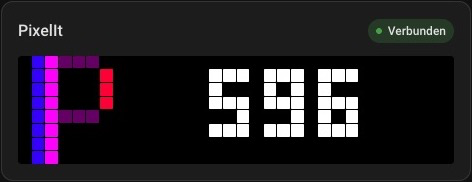
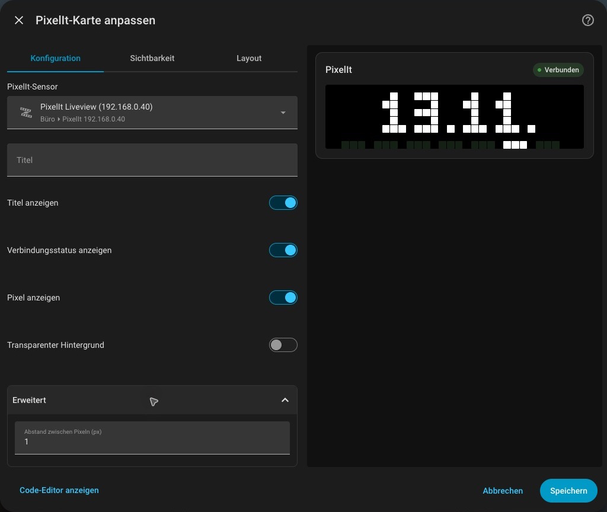

# PixelIt

A custom **Home Assistant integration** for direct display control, persistent playlists, temporary alerts, and a live mirror of the content of a [PixelIt](https://github.com/pixelit-project/PixelIt) matrix display — the clock, bitmaps, text, everything you see on the physical display — as a mini pixel grid on a Lovelace card.

View and control your display through Home Assistant, including in the Companion App and remotely through Nabu Casa.

This integration is maintained by the [PixelIt project](https://github.com/pixelit-project) in [pixelit-project/ha-pixelit](https://github.com/pixelit-project/ha-pixelit).

## Features

- **Direct control** — Power, brightness and messages over WebSocket, without MQTT
- **Managed playback** — Persistent named screens, playlists and temporary alerts
- **Gallery bitmaps** — Optional bitmap/animation IDs with bounded downloads and caching

- **Live pixel mirror** — Shows exactly what the PixelIt display is currently showing (rendered from the real LED pixels, ~250ms updates)
- **Works over Nabu Casa / remote** — Uses a HA sensor, not a direct device WebSocket, so it works in the Companion App and from outside your LAN
- **Self-healing connection** — Automatically reconnects if the PixelIt WebSocket goes stale (e.g. after a color change in the PixelIt WebUI)
- **Automatic card registration** — The Lovelace card is registered as a resource automatically, no manual setup
- **Config flow** — Configure IP and matrix size via the HA UI, no YAML editing
- **Theme-compatible** — Follows your HA theme, with an optional transparent background
- **Connection status badge** — Shows "Connected" / "Disconnected"
- **Multi-language** — English and German UI (auto-detects HA language)



## Installation

### Marketplace / HACS (recommended)

1. Add `https://github.com/pixelit-project/ha-pixelit` as a custom repository in Marketplace (HACS on earlier Home Assistant versions) as an **Integration**
2. Install
3. Restart Home Assistant
4. **Settings → Devices & Services → Add Integration → PixelIt**
5. Enter the PixelIt IP and matrix size
6. Add the card to your dashboard (it's auto-registered as a resource)

### Manual

1. Copy the `custom_components/pixelit/` folder to your `config/custom_components/`
2. Restart Home Assistant
3. **Settings → Devices & Services → Add Integration → PixelIt**
4. Enter the PixelIt IP and matrix size
5. Add the card to your dashboard

In storage mode, the integration registers the dashboard resource automatically and updates the old `/local/pixelit-liveview-card.js` resource on upgrade. If your dashboard resources are managed in YAML, set the resource URL to `/pixelit/pixelit-card.js` with type `module`.

## Configuration

Requires Home Assistant 2025.10 or newer.

The integration is configured via the **config flow** (HA UI), no YAML needed. When you add the integration you are asked for:

| Field | Description |
|-------|-------------|
| **PixelIt display IP address** | The IP of your PixelIt (e.g. `192.168.178.8`) |
| **Matrix width in pixels** | Width in pixels (e.g. `32`) |
| **Matrix height in pixels** | Height in pixels (e.g. `8`) |
| **Bitmap API UUID** | Optional UUID sent to the gallery API when resolving bitmap IDs |

> Note: The labels are shown in German if your Home Assistant language is German, otherwise in English.

Each display has its own sensor. Home Assistant derives new entity IDs from the display name. Registered entity IDs stay the same. The card editor preselects the sensor when exactly one PixelIt sensor is available. If you have several displays, choose the matching sensor.

To change the address or dimensions, open the PixelIt integration entry and choose **Reconfigure**. Existing cards retain their sensor assignment.

### Card Options

Choose your PixelIt sensor, set an optional title and select what to show. The
connection status can stay visible even when the title is hidden. Matrix size is
detected automatically. Pixel spacing is under **Advanced** and adapts on narrow
cards. Enable **Transparent background** to use the earlier frameless appearance.

| Option | Type | Default | Description |
|--------|------|---------|-------------|
| `entity` | string | Automatically selected when exactly one PixelIt sensor is available | Sensor exposing the liveview data |
| `gap` | int | 1 | Pixel spacing, 0–16; found under Advanced |
| `title` | string | `PixelIt` | Card title |
| `show_header` | bool | true | Show card title |
| `show_status` | bool | true | Show connection status badge |
| `show_pixels` | bool | true | Show the pixel grid |
| `transparent` | bool | false | Hide the card background and border |



## Upgrading from PixelIt Liveview

The integration domain is now `pixelit` and the component directory is
`custom_components/pixelit`. Home Assistant does not automatically migrate entries
from the previous `pixelit_liveview` domain.

Before upgrading, note your host, matrix dimensions and existing
entity IDs. Remove the old integration entry, install the new component (remove
the old `custom_components/pixelit_liveview` directory), restart Home Assistant,
and add **PixelIt** again. Reassign the new entities in cards and automations, or
rename them to your previous entity IDs in HA. Existing entity history is tied to
the entity ID. Update action calls to `pixelit.show_message`.

The old `custom:pixelit-liveview-card` type and integration-hosted resource URLs
remain supported as aliases. Storage-mode resources, including old `/local/`
resources, are migrated to the new URL automatically. YAML-managed resources must
be updated manually. New dashboards use `custom:pixelit-card` and the resource
`/pixelit/pixelit-card.js`. Check the selected sensor after adding the integration.
This is a manual migration; existing device and entity registry IDs are not
transferred automatically.

## Controlling your display

The **Display** entity lets you switch PixelIt on or off and adjust brightness.
No MQTT setup is needed. You can use the actions below in HA automations and
scripts. Replace `light.your_pixelit_display` with your Display entity.

### Use the action forms

In **Developer tools → Actions**, or in an automation, select a PixelIt action and
choose your display. For messages, notifications and saved displays, enter the
text directly, select a color with the color picker and optionally add a Gallery
icon. No screen YAML is needed. **Show clock** lets you save a clock instead.

**Text appearance** contains scrolling, large font and centering. **Advanced**
contains animation speed and the optional custom screen editor. In **Start
playlist**, add the saved display names individually in the desired order.
**Show saved display** only needs its name; **Stop playlist** only needs a target.

The examples below are optional for users who prefer YAML.

### Send a message with an icon

Choose an icon in the PixelIt gallery and copy its numeric ID. Set `icon` to that
ID; static and animated icons are recognized automatically. The text appears next
to the icon.

```yaml
action: pixelit.show_message
target:
  entity_id: light.your_pixelit_display
data:
  message: "Waschmaschine fertig"
  icon: 42
  color: "#00FF00"
```

Replace `42` with your icon ID. This message stays on the display and stops an
active playlist. For animated icons, you can optionally set
`icon_animation_delay: 100` to change the time between frames in milliseconds.
Icons are downloaded when needed, so Gallery icons require internet access.

### Show a temporary notification

Use `show_alert` to interrupt your playlist for ten seconds and then continue it:

```yaml
action: pixelit.show_alert
target:
  entity_id: light.your_pixelit_display
data:
  icon: 42
  duration: 10
  message: "Waschmaschine fertig"
  color: "#00FF00"
```

Without a playlist, the last content managed by this integration returns.
If there is none, the display returns to its clock. A new notification replaces
any previous notification. HA must stay running for the automatic return.
Content sent by other apps cannot be restored automatically.

### Rotate between displays

First store each display using `pixelit.set_screen`. For example, a clock:

```yaml
action: pixelit.set_screen
target:
  entity_id: light.your_pixelit_display
data:
  name: clock
  duration: 10
  clock: true
```

Then store a text display with an icon:

```yaml
action: pixelit.set_screen
target:
  entity_id: light.your_pixelit_display
data:
  name: welcome
  duration: 5
  icon: 42
  message: "Willkommen"
```

Start your playlist with the names you saved:

```yaml
action: pixelit.set_playlist
target:
  entity_id: light.your_pixelit_display
data:
  screens: [clock, welcome]
```

The clock appears for ten seconds, then the welcome message for five seconds.
The playlist repeats until stopped. Screens and playlists survive an HA restart;
rotation pauses while the display is off or disconnected.

- **`pixelit.show_screen`**, with `name`: show one saved display and stop rotation.
- **`pixelit.stop_playlist`**: stop rotation and leave the current content visible.
- **`pixelit.set_screen`**: update saved content, including from an automation.

Avoid running a playlist in Node-RED and HA on the same display simultaneously.
MQTT controls can remain enabled, but they appear as separate entities.

The optional `protection_duration` on `show_message` blocks other content for a
while; it does not make the message disappear. For temporary messages, use
`show_alert` with `duration` instead. Earlier development versions used `duration`
for this protection field; update those `show_message` calls.

See the [technical reference](docs/technical-reference.md) for advanced screen
options, supported limits and implementation details.

## Credits

Special thanks to [Pissbirne](https://github.com/Pissbirne), the original creator, for the idea and initial implementation of PixelIt Liveview. Their work on [pixelit-liveview-card](https://github.com/Pissbirne/pixelit-liveview-card) laid the foundation for this integration, which is now maintained and developed further by the PixelIt project.

## License

MIT — see [LICENSE](LICENSE). Original copyright notices are preserved.

## Support

Report bugs and request features in the [issue tracker](https://github.com/pixelit-project/ha-pixelit/issues).
