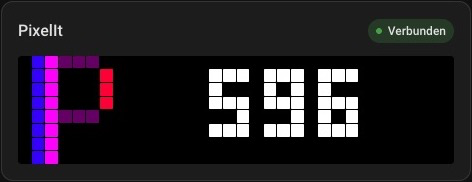
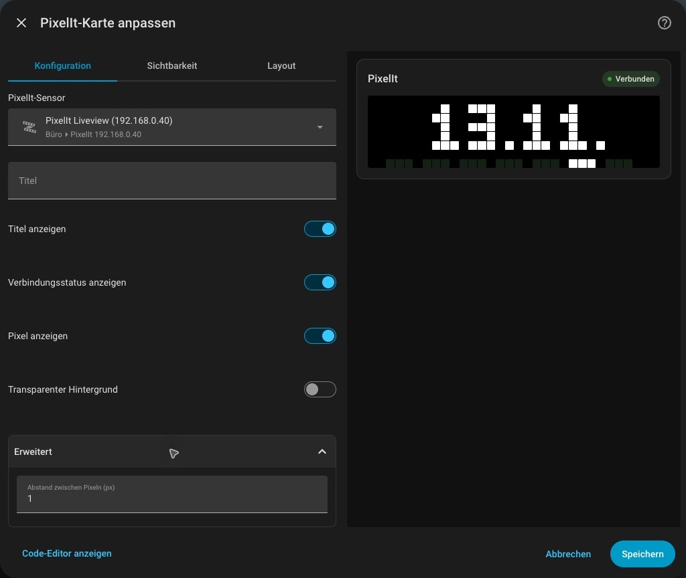

# PixelIt

Control your [PixelIt](https://github.com/pixelit-project/PixelIt) LED matrix
from Home Assistant: send messages, rotate saved screens, show temporary
notifications and mirror the physical display on your dashboard.

The integration connects directly over WebSocket. MQTT and Node-RED are optional.
The dashboard card also works in the Companion App and through your existing
remote Home Assistant access, including Nabu Casa.

Maintained by the [PixelIt project](https://github.com/pixelit-project).

Maintainers can [publish stable, beta and RC releases using version tags](docs/releases.md).

## Features

- **Display control** — Switch the matrix on or off and adjust brightness.
- **Messages and notifications** — Choose text, color, static or animated Gallery icons and screen transitions in the action forms.
- **Saved screens and playlists** — Keep named screens and playlists across Home Assistant restarts. Temporary alerts interrupt playback and then resume managed content.
- **Liveview card** — Mirror the actual LED pixels with connection status, theme styling, optional transparency and responsive sizing.
- **Device sensors** — Read environmental, ambient light and battery values when the device reports them; enable optional diagnostics as needed.
- **UI setup** — Configure each display through Home Assistant, with automatic dashboard resource registration in storage mode.
- **English and German** — Translated setup, entities, actions and card editor.



*Liveview card in Home Assistant's card preview, using a connected PixelIt display.*

## Requirements

- Home Assistant **2025.10 or newer**.
- A PixelIt display reachable from Home Assistant on WebSocket port **81**.
- [PixelIt firmware 3.0.0](https://github.com/pixelit-project/PixelIt/releases/tag/3.0.0) for the current stable firmware and all listed transitions. Older firmware may support fewer effects.
- Internet access from Home Assistant when downloading Gallery icons. Direct display control and Liveview use the local connection.

## Installation

### Marketplace / HACS (recommended)

1. Open Marketplace / HACS, search for **PixelIt** and open its repository page. You can also use this button:

   [](https://my.home-assistant.io/redirect/hacs_repository/?owner=pixelit-project&repository=ha-pixelit&category=integration)

2. Download **PixelIt** and restart Home Assistant.
3. Open **Settings → Devices & services → Add integration → PixelIt**.
4. Enter the display's IP address and matrix dimensions (for example, `32` × `8`).
5. Edit your dashboard, choose **Add card → PixelIt**, select the display's **Liveview** sensor and save.

If PixelIt does not appear in the search results, add
`https://github.com/pixelit-project/ha-pixelit` under **Custom repositories** with
type **Integration**, then follow steps 2–5 above.

### Manual

1. Copy the `custom_components/pixelit/` folder to your `config/custom_components/`
2. Restart Home Assistant
3. **Settings → Devices & Services → Add Integration → PixelIt**
4. Enter the PixelIt IP and matrix size
5. Add the card to your dashboard

In storage mode, the integration registers the dashboard resource automatically and updates the old `/local/pixelit-liveview-card.js` resource on upgrade. If your dashboard resources are managed in YAML, set the resource URL to `/pixelit/pixelit-card.js` with type `module`.

## Configuration

The integration is configured via the **config flow** (HA UI), no YAML needed. When you add the integration you are asked for:

| Field | Description |
|-------|-------------|
| **PixelIt display IP address** | The IP of your PixelIt (e.g. `192.168.178.8`) |
| **Matrix width in pixels** | Width in pixels (e.g. `32`) |
| **Matrix height in pixels** | Height in pixels (e.g. `8`) |

> Note: The labels are shown in German if your Home Assistant language is German, otherwise in English.

Each display has its own Liveview sensor. Home Assistant derives new entity IDs from the display name. Registered entity IDs stay the same. The card editor preselects the sensor when exactly one PixelIt Liveview sensor is available. If you have several displays, choose the matching sensor.

To change the address or dimensions, open the PixelIt integration entry and choose **Reconfigure**. Existing cards retain their sensor assignment.

### Card Options

Choose your PixelIt **Liveview** sensor, set an optional title and select what to show. The
connection status can stay visible even when the title is hidden. Matrix size is
detected automatically. Pixel spacing is under **Advanced** and adapts on narrow
cards. Enable **Transparent background** to use the earlier frameless appearance.

| Option | Type | Default | Description |
|--------|------|---------|-------------|
| `entity` | string | Automatically selected when exactly one PixelIt Liveview sensor is available | Sensor exposing the liveview data |
| `gap` | int | 1 | Pixel spacing, 0–16; found under Advanced |
| `title` | string | `PixelIt` | Card title |
| `show_header` | bool | true | Show card title |
| `show_status` | bool | true | Show connection status badge |
| `show_pixels` | bool | true | Show the pixel grid |
| `transparent` | bool | false | Hide the card background and border |
| `light_entity` | string | Empty | PixelIt Display light to control; select separately from the Liveview sensor |
| `show_power` | bool | false | Show an optional power button |
| `show_brightness` | bool | false | Show an optional brightness slider |
| `tap_action` | object | `action: more-info` | Optional action when tapping the card |
| `hold_action` | object | `action: none` | Optional action when holding the card |
| `double_tap_action` | object | `action: none` | Optional action when double-tapping the card |

Under **Actions**, independently choose what tapping, holding or double-tapping
should do using the Home Assistant action selector. Like the standard HA entity
card for sensors, tapping defaults to **More information** for the Liveview sensor;
holding and double-tapping default to **None**. Each can be overridden, including
setting tapping to **None**.
For example, choose **More information**, navigate to a dashboard, open a URL,
or perform an action on a separately selected PixelIt light or script. Opening a
custom popup requires a corresponding action provided by your popup integration.
Keyboard users can press Enter or Space for the tap action, or Shift with either
key for the hold action. Scrolling or dragging cancels the gesture.

Optional YAML example (replace both entity IDs with your own):

```yaml
type: custom:pixelit-card
entity: sensor.your_pixelit_liveview
tap_action:
  action: more-info
hold_action:
  action: perform-action
  perform_action: light.toggle
  target:
    entity_id: light.your_pixelit
```



*Current editor in German; labels follow your Home Assistant language.*

For a manually configured card, replace the entity below with your Liveview sensor:

```yaml
type: custom:pixelit-card
entity: sensor.your_pixelit_liveview
title: PixelIt
show_status: true
```

Under **Display controls**, select the matching PixelIt **Display** light entity
and optionally enable the power button, brightness slider, or both. They are hidden
by default and do not trigger the Liveview tap/hold/double-tap actions. Controls
follow HA entity feedback and are disabled when the light is unavailable or a
command is pending. The brightness slider sends one command when released and
turns the display on. Automatic brightness may subsequently adjust brightness.

```yaml
type: custom:pixelit-card
entity: sensor.your_pixelit_liveview
light_entity: light.your_pixelit_display
show_power: true
show_brightness: true
```

Alternatively, use a separate standard Home Assistant light card for power and brightness;
the PixelIt card mirrors the display.

## Upgrading from PixelIt Liveview

The integration domain is now `pixelit` and the component directory is
`custom_components/pixelit`. Home Assistant does not automatically migrate entries
from the previous `pixelit_liveview` domain.

Before upgrading, note your host, matrix dimensions and existing
entity IDs. Remove the old integration entry, install the new component (remove
the old `custom_components/pixelit_liveview` directory), restart Home Assistant,
and add **PixelIt** again. Reassign the new entities in cards and automations, or
rename them to your previous entity IDs in HA. Existing entity history is tied to
the entity ID. Update action calls to `pixelit.show_message`.

The old `custom:pixelit-liveview-card` type and integration-hosted resource URLs
remain supported as aliases. Storage-mode resources, including old `/local/`
resources, are migrated to the new URL automatically. YAML-managed resources must
be updated manually. New dashboards use `custom:pixelit-card` and the resource
`/pixelit/pixelit-card.js`. Check the selected sensor after adding the integration.
This is a manual migration; existing device and entity registry IDs are not
transferred automatically.

## Sensors

The integration includes readings from your display without needing MQTT:

- Temperature, humidity, air pressure and gas resistance, depending on the installed sensor.
- Ambient light level.
- Battery level on displays with battery support.

Only sensors reported by the device are added. Values become unavailable if the
display disconnects or a measurement is invalid. Temperature follows the device's
Celsius/Fahrenheit setting and is displayed in your preferred HA unit.

Wi-Fi signal and quality, network information, uptime, CPU frequency, firmware
versions and memory information are also available as diagnostic entities.
These are disabled initially to keep your device page and history focused.
Open your PixelIt device and enable the diagnostic entities you need.
Hardware-specific memory values appear only on devices that provide them.
A separate **Firmware** update entity is enabled by default and shows available
firmware updates directly in Home Assistant, without MQTT Discovery. It uses the
release information reported by the display, including its prerelease setting;
there are no additional release checks or device requests. Until the device has
completed its check, the update status may be unknown. Install firmware using the
existing WebUI or Webflasher workflow; this entity only reports availability.
You can use its update state in automations for your own notifications.

If MQTT Discovery is also active, its entities remain separate entities. This
addition replaces MQTT firmware update reporting, not every MQTT control.

## Controlling your display

The **Display** entity lets you switch PixelIt on or off and adjust brightness.
No MQTT setup is needed. You can use the actions below in HA automations and
scripts. Replace `light.your_pixelit_display` with your Display entity.

### Automatic brightness, clock and buttons

The **Automatic brightness** switch enables or disables the device's ambient-light
brightness control. The **Automatic clock** switch controls the firmware clock
fallback; **Clock fallback delay** sets its delay from 1 to 86400 seconds.
These controls show device feedback, rather than assuming a command succeeded.
Clock changes also require HTTP access from Home Assistant to the display on port 80.

**Changing automatic clock settings restarts the display on current firmware.**
The integration reconnects and resumes its managed playback. The automatic clock
and its delay are saved on the device; the brightness switch changes its runtime
setting. Firmware clock fallback can replace displayed content independently of
Home Assistant playlists.

Each button enabled in the device settings gets a pressed/released binary sensor
and an event entity with `press` and `release` events for automations. Initial
connection and reconnect snapshots do not generate button events. Disabled buttons
are unavailable. The integration requires no MQTT and does not poll buttons.
Single-, double- and long-press gesture events are currently available only through
firmware MQTT; native gesture delivery needs a firmware extension.

### Use the action forms

In **Developer tools → Actions**, or in an automation, select a PixelIt action and
choose your display. For messages, notifications and saved displays, enter the
text directly and optionally add a Gallery icon. **Show clock** lets you save a
clock instead.

**Text appearance** contains text color, scrolling, font size and centering.
Set **Scroll speed** (YAML: `scroll_delay`) to 10–10,000 milliseconds per pixel
step. Lower values scroll faster. Leave it blank to use the display default.
**Icon animation** contains frame timing, back-and-forth playback and loop count.
**Transition** contains the effect and its optional Gallery image. The custom
screen editor is under **Advanced**.

With PixelIt firmware **3.2.0-beta.0 or newer**, **Text appearance** also offers a
gradient end color, rainbow text and eight gradient directions. Leave the
direction unset to change colors per character. Rainbow takes precedence over the
gradient end color. **Character colors (YAML)** can override the first 64
positions, counting spaces. For example, `["#FFFFFF", null, "#FFD000"]` sets the
first and third positions and keeps the second position's regular color.

With firmware **3.2.0-beta.1 or newer**, set **Gradient cycle** or
`gradient_cycle_ms` to animate the gradient or rainbow. The value is in
milliseconds per cycle (250–60,000). Leave it unset for static colors.

In **Start playlist**, add the saved display names individually in the desired order.
**Show saved display** only needs its name; **Stop playlist** only needs a target.

The examples below are optional for users who prefer YAML.

### Send a message with an icon

Choose an icon in the PixelIt gallery and copy its numeric ID. Set `icon` to that
ID; static and animated icons are recognized automatically. The text appears next
to the icon.

```yaml
action: pixelit.show_message
target:
  entity_id: light.your_pixelit_display
data:
  message: "Washing machine finished"
  icon: 42
  color: "#00FF00"
```

Replace `42` with your icon ID. This message stays on the display and stops an
active playlist. For animated icons, you can optionally set
`icon_animation_delay: 100` to change the time between frames in milliseconds.
`icon_rubberbanding: true` plays frames back and forth; `icon_limit_loops: 3`
limits playback to three loops (`0` repeats indefinitely). These options are also
available under **Icon animation** and have no effect on static icons.
Icons are downloaded when needed, so Gallery icons require internet access.

### Show a temporary notification

Use `show_alert` to interrupt your playlist for ten seconds and then continue it:

```yaml
action: pixelit.show_alert
target:
  entity_id: light.your_pixelit_display
data:
  icon: 42
  duration: 10
  message: "Washing machine finished"
  color: "#00FF00"
```

Without a playlist, the last content managed by this integration returns.
If there is none, the display returns to its clock. A new notification replaces
any previous notification. HA must stay running for the automatic return.
Content sent by other apps cannot be restored automatically.

### Choose a transition

Messages, notifications and saved displays have a **Transition** dropdown. Choose
**None** for an immediate change or an effect such as **Fade**, **Curtain**,
**Horizontal slide** or **Random**.

```yaml
action: pixelit.show_alert
target:
  entity_id: light.your_pixelit_display
data:
  message: "Washing machine finished"
  duration: 10
  transition: fade
```

Available choices are None, Random, Fade, Colored bar wipe, Zigzag wipe, Bitmap
wipe, Curtain, Pixel dissolve, Horizontal slide, Blinds, CRT, Glitch and Vertical
slide. **Zigzag wipe** uses the selected text color. **Bitmap wipe** additionally
needs a static Gallery image: enter its ID under **Transition → Bitmap wipe image**.
This image is separate from your message icon.

All listed effects are available in stable **PixelIt firmware 3.0.0**.
For older prereleases, Curtain, Pixel dissolve, Horizontal slide, Blinds, CRT and
Glitch require **3.0.0-beta.1 or newer**; Vertical slide requires
**3.0.0-beta.6 or newer**. An unsupported or unidentified firmware version produces
an action error for these effects. Random uses the mix provided by your firmware
and excludes Bitmap wipe.

Choose a transition when saving a display to use it each time that display appears
in a playlist or through **Show saved display**. After a notification, the restored
display uses its own saved transition. To change an existing display's effect,
save it again under the same name with a different transition.

### Rotate between displays

First store each display using `pixelit.set_screen`. For example, a clock:

```yaml
action: pixelit.set_screen
target:
  entity_id: light.your_pixelit_display
data:
  name: clock
  duration: 10
  clock: true
```

Then store a text display with an icon:

```yaml
action: pixelit.set_screen
target:
  entity_id: light.your_pixelit_display
data:
  name: welcome
  duration: 5
  icon: 42
  message: "Welcome"
```

Start your playlist with the names you saved:

```yaml
action: pixelit.set_playlist
target:
  entity_id: light.your_pixelit_display
data:
  screens: [clock, welcome]
```

The clock appears for ten seconds, then the welcome message for five seconds.
The playlist repeats until stopped. Screens and playlists survive an HA restart;
rotation pauses while the display is off or disconnected. Saved screens contain
the values from the time they were saved. To keep a sensor value current, update
its saved screen from an automation when that value changes.

- **`pixelit.show_screen`**, with `name`: show one saved display and stop rotation.
- **`pixelit.stop_playlist`**: stop rotation and leave the current content visible.
- **`pixelit.set_screen`**: update saved content, including from an automation.

Use **Play in playlist** to add Home Assistant conditions to a saved screen.
The screen keeps its place and plays when all conditions pass. If no screen
can play and a screen has conditions, the playlist checks again after 30 seconds. Use `show: []` to clear
the conditions. Existing YAML with `show: true` or `show: false` still works.

```yaml
action: pixelit.set_screen
target:
  entity_id: light.your_pixelit_display
data:
  name: christmas
  show:
    - condition: state
      entity_id: input_boolean.christmas_display
      state: "on"
```

Avoid running a playlist in Node-RED and HA on the same display simultaneously.
MQTT controls can remain enabled, but they appear as separate entities.

The optional `protection_duration` on `show_message` blocks other content for a
while; it does not make the message disappear. For temporary messages, use
`show_alert` with `duration` instead. Earlier development versions used `duration`
for this protection field; update those `show_message` calls.

See the [technical reference](docs/technical-reference.md) for advanced screen
options, supported limits and implementation details.

## Troubleshooting

| Problem | What to check |
|---------|---------------|
| Setup cannot connect | Confirm the IP address and that Home Assistant can reach port 81 on the display. |
| PixelIt card is missing | Check the dashboard resource. Storage mode registers it automatically; YAML mode needs `/pixelit/pixelit-card.js` with type `module`. Refresh the browser after an update. |
| Card is empty or shows the wrong display | Select the matching **Liveview** sensor, rather than an environmental or diagnostic sensor. Check its connection state. |
| Gallery icon fails to load | Check the numeric Gallery ID and Home Assistant's internet connection. Invalid or oversized images are rejected. |
| Transition reports an error | Check the installed firmware version; stable 3.0.0 supports all listed effects. Bitmap wipe requires a separate static Gallery image. |
| Content changes unexpectedly | Check for Node-RED, MQTT, WebUI commands or firmware clock fallback replacing the content. |

For advanced options and limits, see the [technical reference](docs/technical-reference.md).
For development and host test instructions, see [tests/README.md](tests/README.md).
The dashboard card sources and build instructions are documented in
[Card development](docs/card-development.md).

## Credits

Special thanks to [Pissbirne](https://github.com/Pissbirne), the original creator, for the idea and initial implementation of PixelIt Liveview. Their work on [pixelit-liveview-card](https://github.com/Pissbirne/pixelit-liveview-card) laid the foundation for this integration, which is now maintained and developed further by the PixelIt project.

## License

MIT — see [LICENSE](LICENSE). Original copyright notices are preserved.

## Support

Report bugs and request features in the [issue tracker](https://github.com/pixelit-project/ha-pixelit/issues).
